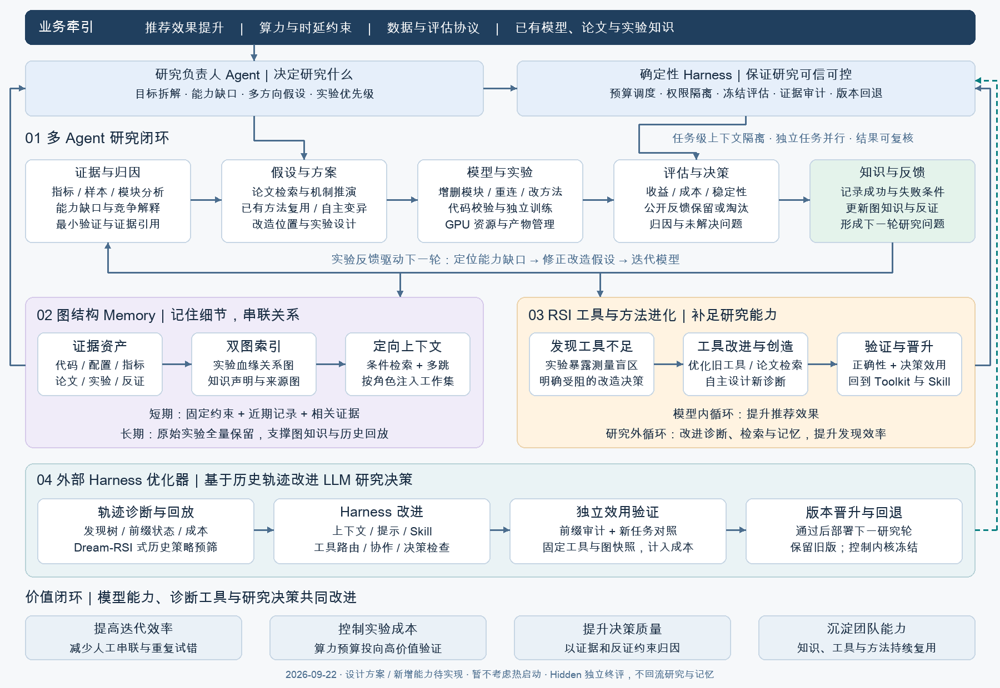

<div align="center">

# rec-harness

### Evidence-Driven Auto Research for Recommender Systems

从模型能力缺口出发，改进推荐模型、诊断工具与研究决策。

**证据驱动改造 · 图知识积累经验 · 历史轨迹改进 Harness**

[完整方案](docs/auto-research-plan.md) · [实验保留与回放契约](docs/dream-rsi-replay-contract.md) · [架构 SVG](docs/auto-research-2026-09-22/architecture.svg) · [知识图谱](docs/auto-research-2026-09-22/knowledge-graph.svg)

最新实验：[Amazon NextItNet 20 轮续跑记录](docs/experiments/amazon-autoresearch-v5-v6.md)（含 GPT-6 Sol low 的 12 轮结果、失败分析与调用统计）。

新 Amazon 示例采用[证据图驱动的四阶段研究](docs/implementation/compact-research-and-evidence-graph.md)：研究设计、实现、独立代码审稿、结果分析与知识更新；晋升规则见[性能与机制分离](docs/implementation/model-promotion-and-mechanisms.md)。旧冻结任务保持原流程。

</div>

---

`rec-harness` 面向推荐与排序模型的长程自动研究：结合当前模型、诊断证据和历史实验，持续修正能力缺口假设，从论文、已有方法与自主变异中提出结构或方法改造，并将实验结果沉淀为可复用知识。

**当前仓库提供 Python 研究运行时、三组 Codex Skills 和设计文档。** 运行时直接调用 `codex exec`，实现顺序角色交付、SQLite 事件与图知识、冻结公开评估、预算、产物归档、受限历史回放，以及工具/Harness 候选验证和版本回退。已完成 CPU 小型示例、Amazon NextItNet 配对实验及工具/Harness 的部分真实在线验收。运行成功不等于候选有效；完整覆盖与未完成项见[实现清单](docs/implementation/completion-matrix.md)。

## 独立方法研究：阶段规划与归因

[`staged-autoresearch/`](staged-autoresearch/README.md) 是独立子项目，检验在 Karpathy 原生编码 agent 循环外增加事前阶段规划、清空上下文后的证据评审及按需归因实验，能否改善相同实验调用预算下的最终成果。计划在 ColoredMNIST、OpenOOD、Opacus 上比较四组方法，共 60 条轨迹、6000 次训练/验证调用。

研究问题、四组对照、预算、指标和结论边界见[实验方案与设计目标](staged-autoresearch/EXPERIMENT_DESIGN.md)。支持[无 Docker 服务器本地后端](staged-autoresearch/SERVER.md)，并已内置[三任务真实评估器、环境与数据下载、一键运行](staged-autoresearch/FML_SETUP.md)，无需手写评估脚本。正式研究实验尚未启动，目标服务器需先通过自动小规模检查和基线验收。该子项目不依赖下述 RecHarness 运行时。

## 快速运行

已封存选中的 Amazon NextItNet 候选、对应基线及单行改动补丁见[模型源码交付](examples/amazon/selected-nextitnet-v3/README.md)。源码保持验收时的精确哈希；开发/确认结果及限制见同页，不包含最终测试结论。

连续多轮、隔离评估及 NextItNet 自动研究使用 [`autoresearch` 单入口](docs/autoresearch.md)，已有[真实两轮验收](docs/autoresearch-acceptance.md)。模型、工具和 Harness 三个循环联动使用其中的[项目总调度](docs/autoresearch.md#项目总调度)，不是单次 `run --rounds 1`。

需要 Python 3.11+ 和已登录的 Codex CLI。Python 运行时无第三方依赖。

在仓库根目录安装后，`rec-harness` 与 `python -m rec_harness` 是相同入口。示例配置位于源码仓库，安装 wheel 不会附带 `examples/`；请保留源码 checkout，并从其根目录使用下方相对路径。隔离运行还需按[运行指南](docs/runtime.md)准备 Codex jail 和 CPU recipe。

```bash
python3 -m venv .venv
. .venv/bin/activate
python -m pip install .
python -m rec_harness --help
```

以下是单轮基础运行；连续自动研究的配置和恢复命令见[单入口说明](docs/autoresearch.md#小型示例)。

```bash
python3 -m rec_harness init examples/toy/campaign.json /tmp/rec-harness-demo
python3 -m rec_harness run /tmp/rec-harness-demo --rounds 1
python3 -m rec_harness verify /tmp/rec-harness-demo
```

这会实际调用 Codex，运行两个 seed 的独立 CPU 训练，并保留所有调用与失败成本。默认使用本机 Codex 模型配置，可在 campaign JSON 的 `codex.model` 指定模型。`examples/toy` 是合成交互回归的框架验收用例，不是推荐效果 benchmark。详细配置、回放、演化验收与部署边界见 [运行指南](docs/runtime.md)，测试和真实 Codex 小型运行结果见 [验收记录](docs/runtime-acceptance.md)。

## 整体架构



业务目标、算力与时延约束、数据及评估协议共同决定研究范围。研究负责人 Agent 决定研究什么；Harness 管理任务执行、预算、证据和版本。

| 层次 | 职责 |
|---|---|
| 多 Agent 研究闭环 | 证据与归因 → 假设与方案 → 模型与实验 → 评估与决策 → 知识与反馈 |
| 图结构 Memory | 实验血缘图与知识声明/来源图联合检索，向不同研究角色提供相关证据 |
| 诊断工具自进化 | 发现测量不足，优化旧工具、检索论文或自主设计新工具，验证后晋升 |
| Harness 外部优化器 | 基于历史决策轨迹诊断研究流程不足，提出 Harness 修改并独立验证 |

三个改进对象分别是**推荐模型能力、诊断工具能力、LLM 研究决策能力**；图知识库连接它们的证据、适用条件和跨轮演进。

## 1. 能力缺口驱动的模型改造

研究围绕具体问题展开：当前模型缺少什么能力，应该增加、删除、替换或重连哪些模块，方法应该放在哪里，增益由什么机制产生？

```text
当前模型 + 任务 + 历史实验
          ↓
能力缺口假设与竞争解释
          ↓
论文 / 已有方法 / 历史经验 / 自主变异
          ↓
改造提案 + 位置与机制 + 可证伪预测
          ↓
实现校验 → 对照实验 → 效果与机制归因
          ↓
更新模型、缺口状态与条件性知识
```

以 TokenMixer 为例，系统需要说明它针对哪种交互缺口、为何放在该位置，以及如何区分交互收益与额外容量带来的收益。诊断用来指导实验，重新训练的对照结果用来验证改造。

本版暂不研究热启动。候选模型按冻结协议独立初始化训练；代码父子关系表示设计血缘，不表示继承父模型权重。模型选择沿用 `keep / discard / provisional / crash / invalid`，与科学结论分别记录。执行失败不自动否定方法，指标提升也不自动证明机制。

## 2. 图结构长期记忆

长期记忆保存“什么条件下，什么改造有效，以及有哪些反证”。同一知识库提供两类关联视图：

| 视图 | 组织内容 | 回答的问题 |
|---|---|---|
| 实验血缘关系图 | 模型版本、组件、提案、实验、对照、观测和成本 | 改过什么？与谁比较？结果怎样？ |
| 知识声明与来源图 | 能力缺口、竞争解释、方法、条件性结论、来源与支持/反证 | 为什么这么判断？何时适用？何时被推翻？ |

两图通过稳定 ID 和证据引用连接。检索先匹配任务、模型角色、协议和时间，再展开支持与反证，形成角色所需的有限上下文。

实验事实逐次追加；长期结论经过证据门槛后更新。冲突通过范围修正、降级、撤回或版本替代处理，保留原始证据。图结构是否提高研究效率，需要与同信息、同预算的平面记忆对照验证。

## 3. 实验驱动的诊断工具自进化

当实验暴露出测量盲区、重复歧义、不稳定估计或过高诊断成本时，系统建立测量缺口，并明确它阻碍了哪个模型改造决策。

```text
实验暴露工具不足
      ↓
优化已有工具 / 论文检索并适配 / 自主设计新诊断
      ↓
正确性 → 合成与负对照 → 稳健性 → 真实数据影子验证
      ↓
增量决策效用与成本验证
      ↓
晋升到 Toolkit / 保留候选 / 拒绝并记录原因
```

新工具既要测得正确，也要在独立实验中优于无工具或现有工具的决策基线。开发和诊断成本计入比较。旧工具升级保留版本、回归检查和回退点；未通过效用验证的工具不进入稳定工具集。

## 4. 独立的 Harness 外部优化器

外部优化器读取多轮研究轨迹，检查 LLM 是否遗漏反证、重复低价值实验、错误解释失败、缺少必要对照，或因角色协作和上下文组织产生错误。

轨迹记录当时可见的证据、候选动作、实际选择、简短理由、工具调用、结果与成本。优化器据此提出最小 Harness 补丁，经历史前缀审计和独立任务验证后，在下一研究轮应用。

| Harness 层次 | 范围 |
|---|---|
| 可优化的研究决策层 | 上下文构建、提示与 Skill、图检索、工具路由、角色交付、实验检查和恢复流程 |
| 稳定控制内核 | 权限隔离、预算账本、冻结评分、原始证据留存和版本验收 |

Harness 候选与旧版使用相同基础模型、工具、起点、图快照和预算进行比较，独立记忆隔离运行。通过效用与回归门槛才晋升；未通过则保留旧版。发现真正的测量缺口时，外部优化器可以向工具进化模块提交需求。

## 5. 保留实验记录，支持 Dream-RSI 式回放

**原始实验档案完整保留，图知识和总结作为派生视图。** 被淘汰、失败、中断和回退的尝试同样保留，未执行候选不伪造为实验结果。

| 记录层 | 内容与用途 |
|---|---|
| 原始实验档案 | 前后工作区、代码与配置、请求/响应、公开观测、失败、资源成本、依赖和版本 |
| 图知识库 | 连接事实、解释、条件、支持及反证 |
| Replay World | 从合格记录构建冻结发现树，逐步揭示已有结果，评价探索策略 |

回放保留根、分支前沿、父子顺序、决策时的可见状态和合法动作、并行批次、跨分支依赖与成本。新策略只能在已记录且依赖满足的支持范围内重排、继续或停止。

修改生成提示、新算法或新工具会产生未知结果，必须真实执行。旧档案缺少关键字段时标记 `audit_only` 或 `partial_replay`，不补造历史；`replay_ready` 需要经过结构、前缀隔离、依赖、产物和成本检查。

已提供本地发现树构建与前缀回放器，**尚未完成 Dream-RSI 官方代码格式适配**。详见[实验保留与回放契约](docs/dream-rsi-replay-contract.md)。

## 当前可用内容与实施状态

| 内容 | 当前状态 |
|---|---|
| Diagnostic Toolkit | 已有表征、激活/梯度和配对干预分析脚本及 Skill |
| Harness Updater | 已有追加式实验、失败、条件性经验和工作状态的文件记忆契约 |
| Diagnostic Tool Evolver | 已有隔离候选管理脚本与分级验证流程 |
| 多 Agent 任务与交付协议 | 已实现顺序角色、独立目录、结构化结果和身份校验；不含分布式调度 |
| 图知识库、双图检索与迁移 | 已实现 SQLite 属性图、事件重建、版本回退、词项/两跳检索与保守迁移 |
| 自动工具进化闭环 | 已实现 Codex 候选开发、冻结验证阶梯和晋升；真实决策效用待验证 |
| Harness 外部优化器 | 已实现独立候选目录、Codex 补丁、验证/晋升/回退；在线效用待验证 |
| Dream-RSI 式发现树与回放 | 已实现归档转换、根/前沿、同步批次、依赖门控和成本；一般 DAG 仅审计 |

现有 Skills：

- [`model-diagnostic-toolkit`](model-diagnostic-toolkit/SKILL.md)：生产可审计测量。
- [`model-optimization-harness-updater`](model-optimization-harness-updater/SKILL.md)：从多轮证据更新研究记忆。
- [`model-diagnostic-tool-evolver`](model-diagnostic-tool-evolver/SKILL.md)：开发并验证候选诊断工具。

用户在自己的公开研究执行环境中提供模型文件白名单、独立检查器与评估命令、seeds 和预算，运行时按冻结合同执行。Hidden 必须由独立身份或隔离服务保管，不能放在研究执行账户可读取的文件系统中。

## 验证与实施顺序

先完成原始事件与图知识基础，再接入缺口—改造闭环、工具效用验证、经验迁移和 Harness 外部优化。每阶段均要求独立证据，不用文本解释质量替代真实研究效果。

主要评价包括固定预算下的模型效果、达到有效改进的成本、失败与重复实验、经验负迁移，以及工具和 Harness 的增量效用。公开反馈用于迭代与选模；Hidden 仅供独立终评，不返回研究 Agent、图知识库或外部优化器。

仓库现有校验：

```bash
bash scripts/validate-core.sh
```

该命令检查核心 Python 语法、已跟踪及未忽略新文件的公开边界，并运行合同、故障、回放与 CPU 闭环测试；不代表真实 GPU 实验已完成验收。贡献要求见 [CONTRIBUTING.md](CONTRIBUTING.md)。

## 文档与实验归档

- [完整 Auto Research 方案 v5](docs/auto-research-plan.md)
- [Dream-RSI 实验保留与回放契约](docs/dream-rsi-replay-contract.md)
- [系统架构图：SVG](docs/auto-research-2026-09-22/architecture.svg) / [Mermaid](docs/auto-research-2026-09-22/architecture.mmd)
- [图知识库结构：SVG](docs/auto-research-2026-09-22/knowledge-graph.svg) / [Mermaid](docs/auto-research-2026-09-22/knowledge-graph.mmd)
- [HTML 阅读版](docs/auto-research-2026-09-22/index.html)：下载文档目录后在浏览器打开；GitHub 文件页不渲染该页面。
- [既有 KuaiRec 与淘宝实验记录](docs/experiments/2026-09-09-kuairec-taobao/README.md)：保留原归档；不将其视为新增图知识库、工具自进化或外部优化器的验证结果。

## 公开边界

本地向量检索的配置、冻结与恢复说明见[语义种子检索](docs/implementation/semantic-retrieval.md)。该功能使用可选依赖，未配置时保留词法检索。

实验全量保留发生在授权研究 workspace 或合规存储中，不表示将原始产物全部公开到 GitHub。本仓库保留可公开的框架代码、设计及实验材料；禁止提交私有模型源码、内部路径、原始数据、checkpoint、凭证或从私有源码复原的模型拓扑。

大产物通过有权限、可校验的引用管理；知识压缩不能删除原始证据，公开发布也不能绕过数据与代码权限。

## License

This project is released under the [MIT License](LICENSE).
