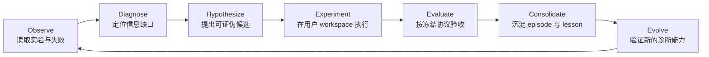

<div align="center">

# rec-harness

### Codex Skills for Evidence-Gated Recommender-System Research

让 Codex 在可审计的实验协议下诊断模型、沉淀长期经验，并验证新的诊断方法。

**Evidence over intuition · Validation over anecdotes · Memory over repetition**

</div>

---

`rec-harness` 是一组面向推荐与排序模型研究的 Codex Skills。它不包含训练平台、业务模型源码、内部数据、实验 checkpoint 或具体模型参考实现；用户需要在自己的训练 workspace 中提供实验入口与评估协议。

## RSI loop



这个闭环改进两类对象：

- **模型研究决策**：根据诊断证据选择更有信息量的下一步；
- **研究能力**：从多轮实验中更新记忆，并对新诊断方法执行独立验证。

## Included Skills

| Skill | Responsibility | Output |
| --- | --- | --- |
| [`model-diagnostic-toolkit`](./model-diagnostic-toolkit/) | 运行框架无关的模型诊断 | collapse、activation/gradient、Shuffle/Zero 等报告 |
| [`model-optimization-harness-updater`](./model-optimization-harness-updater/) | 压缩多轮实验并更新长期研究记忆 | episodes、lessons、failure avoids、strategy |
| [`model-diagnostic-tool-evolver`](./model-diagnostic-tool-evolver/) | 检索、实现并验证新的诊断方法 | 隔离候选、验证记录、接受或拒绝决策 |

## Responsibility boundaries

### Diagnostic toolkit

用于回答“模型内部发生了什么”。它只消费 NumPy 数组或结构化实验表，不依赖 KML、TensorBoard、BlobStore 或指定训练平台。

### Harness updater

用于回答“多轮实验已经教会了我们什么”。它默认只更新持久化研究记忆，不修改诊断工具、训练代码或评估协议。

### Diagnostic tool evolver

用于回答“缺失哪一种观测，才能更快做出下一步决策”。候选方法必须经过论文一致性、合成正确性、真实数据效用和增量决策价值验证，才能进入稳定工具集。

## Installation

将需要的 Skill 目录复制到 Codex Skills 目录，或通过 Git 仓库安装。每个目录中的 `SKILL.md` 都定义了触发条件、输入输出和证据边界。

推荐组合顺序：

```text
model-diagnostic-toolkit
        ↓ compact diagnostic evidence
model-optimization-harness-updater
        ↓ qualified information gap
model-diagnostic-tool-evolver
```

训练、数据和评估仍由用户自己的 GPU workspace 提供。这些 Skills 只读取任务授权范围内的产物，并将结论限制在可追溯证据上。

## Validation

```bash
bash scripts/validate-core.sh
```

验证脚本会检查 Python 工具语法、Skill 必需文件以及禁止进入开源仓库的内部实现路径和标识。

## Repository map

```text
rec-harness/
├── model-diagnostic-toolkit/           # 稳定诊断工具
├── model-diagnostic-tool-evolver/      # 新诊断工具的隔离演化与验证
├── model-optimization-harness-updater/ # 长期研究记忆与策略更新
├── scripts/                            # 开源边界与语法验证
├── app/                                # 文档展示站点
└── public/lessons/                     # 非内部研究材料
```

## Security and publication boundary

禁止提交：

- 公司或私有训练仓库中的模型源码、代码片段和文件路径；
- 数据集、日志、checkpoint、内部实验编号或平台凭证；
- 从内部模型源码复原的精确拓扑、维度表和逐行讲解；
- 可运行的内部训练 controller 或项目专用参考实现。

发现误传时，删除最新文件并不足够；必须从 Git 历史中清除相关 blob，并轮换可能暴露的凭证。

贡献流程见 [`CONTRIBUTING.md`](./CONTRIBUTING.md)。

## License

This project is released under the [MIT License](./LICENSE).
