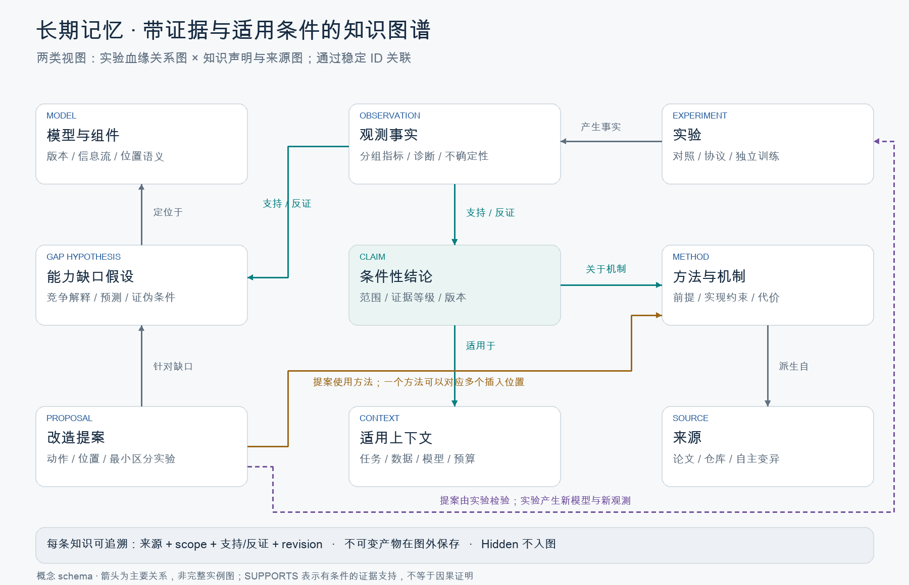

# RecHarness Auto Research：能力缺口驱动的推荐模型改造

版本：2026-09-22 · v5（加入 Dream-RSI 式实验保留与回放契约） · 最新方案修订 · 状态：设计方案，新增能力尚未实现和验收。

核心问题：Agent 能否结合当前模型与历史实验，持续修正对能力缺口的理解，提出有依据的结构或方法改造；当现有诊断不足时，能否改进或创造诊断工具，并通过实验形成可复用知识？

本版聚焦结构、信息流、训练目标和方法改造；暂不研究热启动。候选模型按冻结协议独立初始化训练。代码父子关系表示设计血缘，不表示继承父模型权重。长期记忆采用带证据和适用条件的图知识库。另设独立的 Harness 外部优化器，从历史决策轨迹诊断 LLM 研究决策流程的不足，通过受控修改与验证改进 Harness。

[系统架构图](auto-research-2026-09-22/architecture.svg) · [PNG](auto-research-2026-09-22/architecture.png) · [知识图谱结构图](auto-research-2026-09-22/knowledge-graph.svg) · [可编辑 Mermaid](auto-research-2026-09-22/architecture.mmd) · [阅读版](auto-research-2026-09-22/index.html)

## 1. 相比现有方案，改什么

沿用现有 RecHarness 的三 Skill 分工、追加式实验账本、keep/discard、冻结评估协议、证据门槛和按需演化诊断工具。将研究主线从候选调度转向“理解缺口—定位改造—实验归因”；不把搜索策略本身当作必须成立的研究贡献。

| 原有设计 | 本次更新 | 实现状态 |
|---|---|---|
| 诊断产生测量，Agent 提出下一假设 | 显式维护模型能力缺口、竞争解释和可证伪预测 | 新增问题状态与提案契约，待实现 |
| 论文、经验和候选想法散落于上下文 | 统一方法卡：机制、前提、可插入位置、代价、来源和本地证据 | 待实现 |
| episodes + lessons + strategy 文件 | 事实账本保留；长期知识由带版本的属性图统一管理 | 图存储、写入与检索待实现 |
| keep/discard 表示模型选择 | 选择决策与科学结论分开记录：有效但不涨点也可增加知识 | 待扩展 |
| Diagnostic Toolkit / Harness Updater / Tool Evolver | 保留三者；Updater 扩展为图知识维护，缺口管理和方法提案由研究 Agent 执行 | 现有能力与新增设计分开验收 |
| Bandit、分槽预算和探索阶段 | 降为可选执行策略，首版采用透明的成本与证据优先级 | 不作为本版核心 |

### 本版的学习对象

系统逐步学习三个映射：

1. 模型、数据、现象与诊断 → 有边界的能力缺口假设。
2. 能力缺口、模型位置与已有方法 → 可执行、可证伪的改造。
3. 实验与对照结果 → 有适用条件的经验，并修正此前解释。

这些映射由固定基础模型上的研究角色、工具和图检索实现；研究方法版本可在外循环通过效用验证后升级，不要求修改基础 LLM 权重。图中记录的是有证据约束的研究知识，不是自动成立的因果真相。

## 2. 系统架构与职责


整体按参考图组织为“业务牵引 → 研究负责人 Agent + 确定性 Harness → 多 Agent 研究闭环”，由图结构 Memory 与 RSI 研究方法进化共同支撑。

### 2.1 业务牵引与控制层

业务输入包括推荐效果目标、算力与时延约束、数据与评估协议，以及已有模型、论文和实验知识。

- **研究负责人 Agent**：拆解业务目标，维护能力缺口与多方向假设，决定研究什么、为何研究以及实验优先级；综合各角色结果作出可追溯的决策。
- **确定性 Harness**：分为稳定控制内核与可优化的研究决策层：前者管理预算、权限隔离、冻结评估、证据留存和版本回退；后者组织上下文、提示/Skill、工具路由、角色协作与决策校验。“确定性”指控制与校验规则可复现，不表示 LLM 输出或训练结果完全确定。

### 2.2 多 Agent 研究闭环

| 研究角色 | 主要任务 | 交付物 |
|---|---|---|
| 证据与归因 Agent | 指标、样本、模块分析；维护能力缺口、竞争解释和最小验证 | GapCard 与证据引用 |
| 假设与方案 Agent | 论文检索、机制推演、历史经验复用、自主变异；比较改造位置与方法 | MethodCard、Proposal 与实验合同 |
| 模型与实验 Agent | 代码修改、独立实现校验、训练与实验产物整理 | 候选版本与完整实验记录 |
| 评估与决策 Agent | 汇总公开收益、成本与稳定性，提出保留/淘汰建议和未解决问题 | DecisionRecord；负责人确认候选选择 |
| 知识与反馈 Agent | 记录成功与失败条件，提出图知识补丁，更新下一轮问题 | GraphPatch 与下一轮 EvidenceBundle |

角色按任务实例化、隔离工作目录与上下文；并行只用于不存在依赖的文献检索、独立诊断或候选实验。互相依赖的步骤必须按证据顺序执行。每个任务声明输入版本、输出契约、预算、状态与产物 hash；汇总时拒绝把不同协议或过期模型结果混为一组。

Agent 只能提出判断和补丁；预算扣账、协议校验、产物冻结及图版本提交由 Harness 执行。失败可重试或回退，但所有已消耗成本与旧产物保留。角色间共享已验证的产物引用，不能将对方的自然语言结论当作独立实验证据。

### 2.3 现有能力如何接入角色

以下是功能模块，与上面的角色不是一一对应的独立服务：

| 模块 | 输入 | 输出及职责 |
|---|---|---|
| 模型与任务读取 | 代码、结构、配置、数据语义、训练与评估协议 | 版本化模型结构图；模块路径、输入输出与 token 语义；任务上下文 |
| 缺口管理 | 当前反馈、诊断、历史支持及反证 | GapCard；区分观测、解释、竞争解释和未知信息 |
| 诊断工具 | 合法公开数据、固定模型产物与干预配置 | 测量与不确定性，不直接判定改造收益 |
| 方法获取与改造提案 | GapCard、图检索结果、论文或代码来源 | MethodCard + Proposal；增加、删除、替换、重连或修改训练方法 |
| 实验设计与执行 | 提案、对照、预算、协议 | 独立训练的代码快照、日志、指标、成本和实现校验报告 |
| 验证与归因 | 可比实验、分组指标、针对性对照 | 模型选择决定 + 结论状态 + 仍未排除的解释 |
| 图知识维护 | 原始事实引用、归因草案、历史 Claim | 增量图更新；支持、反证、范围修正、失效和版本关系 |
| Harness 外部优化器 | 带可见状态快照的历史决策轨迹、失败与成本 | 诊断研究决策不足，生成 HarnessPatch，独立验证后晋升 |
| 诊断工具自进化 | 实验中暴露的测量盲区、失真、重复歧义或过高成本 | 优化已有工具 / 论文驱动新工具 / 自主设计新工具，验证后晋升 |

Harness 负责文件、预算、执行、状态转换和恢复；Agent 负责提出解释和实验。可信评估器管理 Hidden，研究 Agent 和图知识库均不能读取其结果。

## 3. 每轮研究如何运行

### 3.1 建立当前状态

读取当前选定模型、冻结协议、剩余预算和图版本。构建有限大小的上下文包：最近实验、相关缺口、条件匹配的经验、反证、实现失败和待验证方法。

模型描述需包含真实代码路径与版本，而不仅是“第几层”。记录每个候选位置的输入输出维度、token 语义、mask、信息来源、残差路径和是否共享参数；缺失信息必须显式标为 unknown。

### 3.2 更新能力缺口假设

先汇总事实，再提出竞争解释。每个 GapCard 至少包含：

```text
gap_id / model_version / task_context / protocol_hash
observation_refs           # 现象的可追溯证据
suspected_capability       # 如跨行为交互、信息读取或任务共享
affected_components       # 具体模块版本与位置
alternative_explanations  # 样本不足、训练不足、实现错误等
predicted_observations     # 若假设成立，预计还应看到什么
cheapest_discriminating_test
status: proposed | supported | contradicted | mitigated | unknown
```

“观测到长序列切片较差”不是“长序列建模不足”已经成立。内部指标只提供证据；低秩、低梯度或 Shuffle 损伤都不能单独推出某个结构应该增加或删除。

每次模型晋升后检查旧 GapCard 的适用性。旧问题可能仍在、已经缓解或因结构变化需要重新测量；不得无条件继承旧结论。

### 3.3 按需要补充诊断

优先复用现有训练曲线、分组指标和历史实验。只有新测量可能改变具体选择时才支付诊断成本。

根据问题选择分层/分任务梯度、表征与读出、窄路径干预、模块交互等诊断。对照冻结配置、训练曲线和历史结果，记录诊断究竟改变了哪个决策。如果反复出现无法区分的解释，再触发 Tool Evolver；不要求每轮演化工具。

### 3.4 从三类来源产生改造

- **论文与已有方法**：围绕缺口检索，提取机制、适用前提、张量约束、位置要求、训练条件、复杂度和来源版本。
- **图中经验**：沿相同任务条件、模块角色和信息流检索成功与失败；来源相近但条件不同的经验作为类比，不能当作直接支持。
- **自主变异与组合**：增加、删除、替换、移动、重连、共享/拆分、改变损失或监督方式。明确修改机制和与已有提案的差异。

论文声明、Agent 推断、本地实验结果分别标为 `paper_claim`、`agent_hypothesis`、`local_evidence`。自主生成方法不得自动宣称新颖或有效。

### 3.5 制定提案与实验合同

```text
proposal_id / gap_ids / method_ids / base_model_id
action: add | remove | replace | move | reconnect | objective | training_method
target_component_ids / mechanism / insertion_contract
expected_primary_and_slice_effects / alternative_explanations
falsification_condition / controls / correctness_checks
train_protocol_hash / seeds / tuning_allowance / budget / guardrails
```

首版按缺口证据、可区分性、实施风险和实验成本选择下一项，不需要训练搜索策略。允许保留少量缺少成熟解释的探索提案，但必须声明不确定性并可被实验否定，避免系统被已有诊断局限封闭。

### 3.6 先校验实现，再验证收益

正确性门槛依次覆盖：设计与公式对应、独立参考计算、关键中间量与梯度、mask/形状/边界、参数注册、真实训练路径。按改动选择必要检查，不能让测试与被测代码复用同一错误逻辑。

通过后按冻结协议独立初始化训练。配对 seeds、数据顺序及可比初始化规则；不同架构不能声称所有权重逐项相同。代码父子关系仅表示设计来源。短程实验只用于筛查，不能据此永久否定学习较慢的架构；结构跳变可使用预先约定且公平的调参窗口，并计入总成本。

### 3.7 将模型决策与知识结论分开

模型决策沿用 `keep / discard / provisional / crash / invalid`，超时等失败保留具体 failure_kind。

知识结论单独记录：

- 观察是否重复出现？
- 是否支持原缺口？哪些竞争解释仍然成立？
- 改造在什么范围内有效？是否排除了容量、训练或实现差异？
- 未涨点是否真正反驳了机制，还是实验无区分力？

`keep` 不等于机制被证明；`discard` 不等于整类方法无效；Crash/OOM 属于执行证据，不能反驳科学假设。

### 3.8 写入事实，按门槛更新知识

每次尝试追加事实与成本。每轮更新缺口的证据引用；长期 Claim 在满足合并触发器时更新。下一轮基于新模型状态和新图快照继续。

## 4. 长期记忆：带证据的图知识库



### 4.1 存储分层

长期研究知识的统一入口是属性图；原始产物和不可变事件保留在图外，通过稳定 ID、路径和内容 hash 关联。

```text
memory/
  events.jsonl                # 不可变事实、知识变更事件；重建与审计依据
  graph/                     # 节点、边、索引和图快照；长期知识的查询层
  context/current.json       # 当前轮的短期工作状态与检索快照
  exports/                   # results.tsv / lessons 等兼容视图，只读生成
artifacts/<experiment_id>/   # 配置、代码、日志、预测和诊断；不塞进 prompt
trusted/                    # Hidden 评分产物，Agent 与图服务不可访问
```

首版可以用 SQLite 的 nodes/edges/events 表实现属性图和事务，节点/边带 JSON 属性，另导出可审计 JSON 快照；不以部署独立图服务为前提。此处是项目内实现选择，尚无图数据库部署。事件日志为事实与变更记录，图为可重建的长期知识投影，避免文件和图两套可写真相。

### 4.2 原始实验记录与 Dream-RSI 式回放

**所有实验记录保留，知识图谱与总结不替代原始档案。** 实验档案同时服务审计、图知识构建和 Replay World。代码、配置、请求/响应、前后工作区、公开评估、失败、成本、图快照与依赖均可追溯；淘汰候选和回退版本也保留。

新增 [实验保留与回放契约](dream-rsi-replay-contract.md)，规定发现树节点、根/前沿动作、可见前缀、并发事件、历史成本与不可回放动作。图检索必须遵守回放时的可见范围；跨分支信息依赖未满足时不得揭示对应后继。

Dream-RSI 式回放用于已有结果支持范围内的分支、停止和批次策略预筛。修改生成提示、模型算法或创造新工具会改变结果，仍需真实执行。旧历史缺字段时标记部分回放或仅审计，不伪造缺失状态。原始记录保留政策与此资格独立。

### 4.3 双图索引与定向上下文

图结构 Memory 采用同一知识库上的两类关联视图，而非两套互不一致的数据：

1. **实验血缘关系图**：组织模型版本、组件、改造提案、实验、对照和观测，回答“改过什么、从哪里改、如何对照、结果是什么”。
2. **知识声明与来源图**：组织缺口、竞争解释、方法、条件性结论、论文及支持/反证，回答“为什么这么判断、依据是什么、何时适用、何时被推翻”。

两图通过 Experiment、Observation、ModelVersion、Claim 的稳定 ID 连接。实验关系不能被误读成权重继承；知识关系不能被误读成无条件因果。

定向上下文通过条件过滤、语义检索与多跳展开形成，按角色注入有限工作集：证据角色重点接收竞争解释与反证，方案角色接收方法前提与历史失败，实验角色接收实现与协议，评估角色接收可比性和护栏，知识角色接收结论血缘与冲突。

短期工作记忆保留固定约束、当前问题、近期记录和相关证据；长期图保留原始细节引用、适用条件和跨轮演进。压缩只改变当前工作集，不删除可追溯事实。

### 4.4 节点类型

| 节点 | 核心属性 |
|---|---|
| Context | 任务、数据版本、切分、特征、用户切片、训练预算、指标与协议 hash |
| ModelVersion | 代码 hash、结构签名、配置、设计父版本、当前选定状态 |
| Component | 模型版本、代码路径、模块类型、输入输出、token 语义和连接位置 |
| Observation | 观测类型、量值与不确定性、时间、公开产物引用；纯事实 |
| GapHypothesis | 能力缺口、竞争解释、预测、状态、当前适用版本 |
| Method | 机制、前提、实现约束、代价、Source 引用或自主变异来源 |
| Proposal | 动作、目标位置、机制、预测、对照与证伪标准 |
| Experiment | 提案、运行身份、对照、seeds、训练预算、代码与数据 hash、状态 |
| Claim | 条件性结论、范围、证据等级、支持/反证、复查条件与失效范围 |
| Failure | 错误签名、复现条件、修复状态；与科学反证分离 |
| MeasurementGap / ToolCandidate / ToolValidation | 测量不足、工具改进候选、各级验证及决策效用证据 |
| DecisionTrace / HarnessVersion / HarnessPatch / HarnessValidation | 历史可见状态、决策流程版本、候选补丁与独立效用验证 |
| ResearchMethodVersion | 研究流程、检索/记忆策略或 Skill 版本；触发证据、效用验证、晋升与回退 |
| Source / ToolVersion | 论文或仓库的精确来源；测量方法与实现版本 |

Component 用 `model_version + module_path + callsite` 区分身份；不同模型中的“第三层”不能直接合并。跨模型通过角色对应关系建立类比，并保留映射不确定性。

### 4.5 关键关系

```text
ModelVersion —HAS_COMPONENT→ Component
Component —FLOWS_TO→ Component
ModelVersion —DERIVED_FROM→ ModelVersion         # 设计来源，非权重继承
Experiment —EVALUATES→ ModelVersion
Experiment —COMPARED_WITH→ Experiment
Experiment —PRODUCES→ Observation
Observation —SUPPORTS / CONTRADICTS→ GapHypothesis 或 Claim
GapHypothesis —LOCATED_AT→ Component
GapHypothesis —ALTERNATIVE_TO→ GapHypothesis
Proposal —TARGETS→ GapHypothesis
Proposal —USES→ Method
Proposal —MODIFIES→ Component
Experiment —TESTS→ Proposal
Claim —APPLIES_IN→ Context
Claim —ABOUT→ Method / Component / GapHypothesis
Claim —SUPERSEDES→ Claim
Method —DERIVED_FROM→ Source / Method
Experiment —HAS_FAILURE→ Failure
```

所有解释性关系都携带 `scope、evidence_refs、origin、status、created_at、revision_id`。`SUPPORTS` 是有条件的支持，不等于证明。支持边自身也须有可比性与证据审核；不能由 LLM 任意写一条边就完成“验证”。

### 4.6 知识写入与版本管理

1. 原始产物完成校验后，先追加 Experiment、Observation 或 Failure 事件。
2. Updater 提出局部图补丁，新增/修订 GapHypothesis、Claim 及证据关系。
3. 确定性检查验证 ID 引用、来源权限、协议可比性、重复血缘与字段完整性；语义支持程度由明确证据规则和必要复查判断，schema 通过不代表结论正确。
4. 事务提交图版本并记录前后 hash；拒绝的补丁也保留原因。
5. 冲突时收窄范围、保留竞争解释或降级；通过 supersedes / retracted 记录演变，不改写旧实验。

合并触发器沿用现有方案：约 5 次有效实验、同机制出现独立可比支持、当前模型晋升、连续未改善、重复故障或人工复盘。触发合并不代表自动晋升结论。

| 等级 | 门槛与含义 |
|---|---|
| provisional | 单次结果或证据尚不足；可引导验证，不作确定规则 |
| supported | 至少两个独立、有效、可比结果支持，且达到预注册效应/不确定性要求 |
| confirmed_in_scope | 在声明范围内，机制对照与重新训练结果一致；仍非普适规律 |
| disputed / demoted | 存在未解释反证或适用性变化，检索时必须显示 |
| superseded / retracted | 被新版本替代或撤回，原证据仍可追溯 |

两份报告、同一次训练的多个 checkpoint、同一批预测的重复 bootstrap，都不算多个独立训练结果。多 seed 只支持相应范围的重复性；跨数据或模型的迁移需要新的验证。置信度使用证据等级和效应区间，避免随意生成精确概率。

### 4.7 每轮怎样检索

先按权限、时间、任务和协议过滤，再匹配组件角色、缺口和方法；语义检索只用于找到种子节点。沿 1–2 跳关系展开支持、反证、失败、替代方法与血缘，在上下文预算内重排。

输出一个 `EvidenceBundle`：当前模型摘要、活跃缺口、少量条件性 Claim、关键支持及反证、相关失败、候选方法、未解决问题、引用路径、`graph_snapshot_id` 与检索记录。必须为反证预留空间；同一血缘大量近似实验不能挤掉其他解释。

常用问题包括：

- 当前问题在相似模型中出现过吗？哪些竞争解释曾被排除？
- TokenMixer 在什么语义位置被试过，在哪些条件下无效？
- 某模块删除后，独立重训是否恢复？它是否依赖另一模块？
- 一条建议来自论文、一次实验，还是多次可比验证？
- 当前结构变化后，哪些旧 Claim 需要重新检查？

图的价值假设是支持关系追溯、条件匹配和冲突检索；必须与同信息、同上下文预算的平面记忆比较，不能把“存成图”本身当成效果提升。

## 5. RSI 外循环：从实验经验改进研究方法

模型内循环提升推荐效果；研究外循环提升发现有效方案的效率。外循环包含“研究复盘 → 方法更新 → 效用验证”，范围不限于候选搜索调度。

### 5.1 研究复盘

依据实验与知识两张图，识别重复失败、错误归因、缺失对照、论文迁移条件不匹配、上下文遗漏和测量盲区。每个待改进项必须指向具体决策或成本损失，并给出对应证据。

### 5.2 研究方法更新

可提出检索规则、上下文构建、缺口分析流程、实验设计模板、Skill 指令或诊断工具的候选更新。将方法版本记录为 ResearchMethodVersion，关联触发问题、变更内容、验证实验和 supersedes 关系。每次限定改动范围，以便判断效果来源。

诊断工具自进化是研究外循环的核心机制之一：它将实验暴露的测量不足转化为可验证的工具改进。Graph Updater 维护证据和知识，不承担任意执行代码或自动修改评估器的权限。

### 5.3 效用验证与晋升

在未用于开发该版本的任务或未来实验上，对旧版本与候选版本做同预算独立对照，统一基础模型和目标训练条件。诊断、检索、Agent 调用、工具开发与训练费用分别记账；优先比较有效方案收益、研究总成本及错误决策率。

先冻结验证规则再观察结果；多个候选在开发集挑选后，再用独立确认评估避免反复筛选偏差。通过才升级研究方法版本；无收益、成本超标或回归则保留旧版，并记录失败条件。历史回放可用于预筛，但不能替代在线新实验的效用验证。

外循环不能修改 Hidden 隔离、证据留存与冻结评分规则。基础工具固定的记忆迁移评测，与允许 Skill/工具更新的端到端 RSI 评测分开报告。

### 5.4 核心机制：实验驱动的诊断工具自进化

模型改造与测量改造构成两个相互促进的闭环：实验检验模型假设，也检验诊断是否足以指导决策；新工具通过验证后返回证据与归因阶段，帮助提出或排除下一次模型改造。

#### A. 发现“工具不足”，而不只是“模型没涨点”

触发信号包括：同一观测无法区分两个会导致不同改法的解释；诊断多次与后续改造结果不一致；现有测量只覆盖整体而遗漏关键任务、样本或路径；估计随 seed/批次强烈波动；重复手写分析说明稳定工具缺接口；测量开销已经超过其决策价值。

这些只是排查信号。先排除工具调用错误、数据不足、实现错误和适用前提不满足；一次模型未提升不能直接证明工具无效。确认工具不足后建立 MeasurementGap，与模型 GapHypothesis 分别存储。

```text
measurement_gap_id / related_gap_ids / experiment_refs
blocked_decision                # 如增加、删除、移动、保留哪个模块
competing_explanations          # 需要区分什么
current_tools_and_versions      # 已试过的工具与其适用前提
observed_limitation             # 分辨率、偏差、稳定性、覆盖或成本
required_information / available_artifacts
cheapest_test / development_budget / acceptance_contract
```

#### B. 三条工具改进路径

| 路径 | 适用情况 | 产物 |
|---|---|---|
| 优化已有工具 | 原测量目标合理，但分组、干预粒度、估计、接口或效率不足 | ToolVersion 新版本；明确修正什么、兼容性与回归风险 |
| 论文检索并实现 | 缺失信息已有相关测量方法，需核对其前提是否适用 | 一手论文方法卡、最小适配实现与来源记录 |
| 自主设计或组合 | 现成方法不能区分目标解释，或需要新的局部干预/估计 | 显式定义测量量、算法、预期行为、失败条件与最小实现 |

Agent 先在已有工具及失败候选图中检索，再选择路径。论文路线核对精确测量对象、假设、输入、复杂度与已知失败模式；自主路线同样必须有可检验的定义，不能只生成看似合理的分数。算法有变化即保留独立版本；实质不同的测量量使用新的工具 ID。

#### C. 隔离实现与验证阶梯

候选工具在独立目录实现，只读取授权的公开产物，测量阶段不改训练目标、模型权重或评分规则。既有工具也通过候选版本优化，不直接覆盖稳定版。

1. **定义与实现正确性**：论文路线对齐公式或参考输出；自主路线使用独立参考计算和可解析例子。
2. **合成可辨识性**：构造已知冗余、互补或交互情形；加入负对照，验证该测量确实能区分目标解释。
3. **稳健性**：检查形状、空输入、非有限值、mask、随机性、样本量与资源开销。旧工具升级同时做必要回归检查。
4. **真实数据影子验证**：在至少两个相关模型状态、seed 或实验条件上只读运行；不因产生新分数就改变 incumbent。
5. **增量决策效用**：预先定义目标决策，在未用于开发的实验上比较“无该工具”“现有工具”“候选工具”。固定候选集测试选择能力；端到端测试则记录其是否改善候选生成。结论分开报告。
6. **成本与回归**：计入开发、取样、诊断和维护成本；无工具组可将节省预算用于更多训练或候选验证。只有收益与代价满足预注册门槛才晋升。

状态为 proposed → implemented → offline_validated → shadow_validated → utility_validated → promoted；失败保留 rejected，替代关系保留 superseded。缺少真实实验预算时停在 offline_validated，不把合成正确性冒充实际效用。

验证数据与开发数据分开，避免工具针对已有胜负标签设计后又在同一组实验上自证有效。固定 checkpoint 的依赖测量与重训后的改造收益是不同目标，必须通过明确的决策实验建立联系。

#### D. 回到模型研究与图知识库

通过门槛后注册工具的版本 hash、输入输出、适用范围、调用成本、测试和回退点，再更新 Toolkit 与相应 Skill 的使用说明。复测受影响的缺口，生成新的模型提案；旧诊断产物仍指向旧 ToolVersion，不被重算结果覆盖。

图中新增节点 MeasurementGap、ToolCandidate、ToolVersion、ToolValidation，并连接：

```text
Experiment —EXPOSES→ MeasurementGap
MeasurementGap —BLOCKS→ Proposal / GapHypothesis
ToolCandidate —ADDRESSES→ MeasurementGap
ToolCandidate —BASED_ON→ Source / ToolVersion
ToolValidation —EVALUATES→ ToolCandidate
ToolVersion —PROMOTED_FROM→ ToolCandidate
Observation —MEASURED_BY→ ToolVersion
ToolVersion —SUPERSEDES→ ToolVersion
```

有效性、失效条件和拒绝原因均入图。ToolValidation 不自动产生模型有效性的 Claim；工具改进后也必须用新的模型实验检验其建议。

#### E. TokenMixer 场景示例（待验证假设）

假设现有整体 Shuffle 发现某交互模块影响小，但无法区分“该模块冗余”与“只有某类行为组合依赖它”。系统由此提出测量缺口，而不是立即删除模块。

最小改进先给已有工具增加预先定义的样本分组、配对扰动和不确定性估计。若还无法排除替代路径，再检索相关方法或自主构造局部路径与联合干预诊断。联合效应定义清楚，避免把分数差的非线性误当作结构交互。

候选工具必须先在可控例子上区分已知冗余与互补，再在独立模型实验中检验它是否更准确地建议保留、删除或移动模块。若它只生成了更细的报告而没有增加信息或改变正确决策，则保留为探索工具或拒绝晋升。

### 5.5 核心机制：独立的 Harness 外部优化器

外部优化器不承担当前轮的推荐模型修改，而是审视执行研究的 LLM 决策流程。其输入是多轮或多任务的历史轨迹，输出是版本化 Harness 改进。这里“LLM 决策算法”指提示、上下文、记忆检索、工具使用、协作和控制流程共同形成的可观测决策策略，不涉及读取模型隐含思维或默认修改基础模型权重。

```text
研究 Agent + Harness v_t → 执行模型研究 → 产生决策轨迹
                               ↓
外部优化器：轨迹诊断 → HarnessPatch → 隔离验证
                               ↓
独立验收器：通过则部署 v_t+1；否则保留 v_t
```

#### A. 外部性的边界

外部优化器使用独立工作目录、上下文、开发预算和版本库；可以使用同一基础 LLM，独立的是角色、权限与验证流程。当前研究 episode 内锁定 Harness 版本；补丁只在下一 episode 或明确检查点应用，不能在运行中悄然替换。

稳定控制内核包含数据权限、Hidden 隔离、评分定义、预算账本、原始事件和验收器。外部优化器不能改写这些部件。可优化的研究决策层包括问题分解、上下文构造、检索与反证规则、提示/Skill、工具调用顺序、角色交付契约、实验设计检查、失败恢复和停止条件。

候选开发者不能自行降低验收阈值或宣布晋升；Harness 的固定验收流程验证预注册指标并提交版本。基础 LLM、任务资格和外层优化协议冻结，否则无法归因 Harness 改动。

#### B. 轨迹必须包含当时看到了什么

只保留最终指标和事后总结不够。每个决策事件记录：

```text
trace_id / task_id / episode_id / decision_id / timestamp
harness_version / skill_versions / tool_versions / base_llm_version
model_version / graph_snapshot_id / protocol_hash
visible_state_ref / evidence_bundle_hash / retrieved_node_ids
candidate_actions_and_constraints / selected_action
brief_rationale_and_evidence_refs / predicted_outcome / uncertainty
validation_checks / tool_calls_and_results / failures
observed_outcome / resource_cost / selection_decision
```

visible_state 保存合法可见的输入引用与版本；brief_rationale 是可审计的简短理由，不要求保存私有思维链。候选动作只记录当时实际提出的动作，不事后补造。决策重演不得看到未来实验结果或当时未检索到的证据；轨迹优化也不得读取任务 Hidden。

#### C. 对决策失误作可检验诊断

| 轨迹中的现象 | 外部优化器检查什么 | 候选 Harness 改动 |
|---|---|---|
| 重复做已有反例的改造 | 反证未被检索，还是已见但未纳入判断？ | 修改检索、上下文配额或反证检查 |
| 工具无法区分解释却仍下确定结论 | 缺少测量，还是误解了工具的适用范围？ | 调用 Tool Evolver，或增加诊断边界校验 |
| 一次失败就淘汰整类方法 | 是否把执行失败、短程不收敛当作机制失败？ | 修改失败分类与复验流程 |
| 很多实验无从归因 | 提案时是否改变过多因素或遗漏必要对照？ | 修改实验合同与设计检查 |
| 不同角色结论冲突 | 输入版本、任务协议是否不同？ | 修改角色上下文与交付校验 |
| 只反复微调同一方向 | 是缺口证据支持，还是上下文偏置与提案重复？ | 修改问题拆解、候选去重与替代解释要求 |

每条诊断引用实际轨迹、竞争解释和可验证预测。未改善的结果不自动意味着坏决策；一次有信息价值的反证实验可能是合理选择。诊断先提出假设，验证才判断补丁是否改进决策。

#### D. 从诊断到 HarnessPatch

每次补丁包含 `failure_pattern、trace_refs、causal_hypothesis、editable_scope、patch_diff、expected_decision_change、regression_risks、validation_plan、rollback_version`。

先尝试最小改动。例如“检索成功经验时必须联合展开同 Claim 的反证”，比重写整个研究提示更易检验。若真正缺失测量能力，外部优化器向 Tool Evolver 提交 MeasurementGap；工具开发与 Harness 调用策略更改保留两个版本、分阶段验收，避免把测量收益与决策流程收益混为一谈。

#### E. 三层验证与晋升

1. **离线轨迹审计**：按历史可见前缀重演，检查补丁是否减少已知违规、遗漏、重复与错误引用。固定历史只能验证已有观测支持的决策，不能把未经执行的新动作赋予历史分数。
2. **独立开发验证**：在未参与补丁诊断的任务/模型血缘上，旧 Harness 与候选 Harness 使用相同基础模型、工具版本、起点、图快照与总预算进行配对运行；每个运行使用独立记忆 overlay，禁止互相污染。明确一次只比较 Harness，或另设包含工具变化的联合试验。
3. **冻结确认评估**：从多个候选中选定版本后，用未反复用于调优的确认任务验证有效改造收益、成本、可靠性和退化。最终 benchmark Hidden 留给独立报告，不作为外部优化器反复选择版本的信号。

效用同时看固定预算下模型收益、达到阈值的成本、实现/协议失败、无效重复与可证伪实验比例。不能仅优化“轨迹看起来更合理”或让优化器自行打分。报告 Harness 开发成本、部署成本和复用后的摊销；多个随机种子和任务血缘的相关性需在统计中考虑。

通过预注册效用及回归门槛才晋升，保留旧版本与回退点；证据不足则 provisional。单轮更新频率受独立开发预算控制，不能通过无限修改 Harness 挤占模型实验并掩盖成本。

#### F. 图知识与三类学习对象

新增 DecisionTrace、DecisionFailureHypothesis、HarnessVersion、HarnessPatch、HarnessValidation 节点。关系包括 `Trace—GENERATED_BY→HarnessVersion`、`Hypothesis—SUPPORTED_BY→Trace`、`Patch—ADDRESSES→Hypothesis`、`Validation—EVALUATES→Patch`、`HarnessVersion—SUPERSEDES→HarnessVersion`。保留支持、反证和失败补丁。

由此形成三个有明确对象的改进循环：

- 模型改造：提高推荐模型的能力。
- 工具进化：提高测量能力与诊断的决策价值。
- Harness 外部优化：提高 LLM 使用证据、组织实验与形成结论的能力。

图知识库为三者保存和检索经验；外部优化器优化执行研究的决策流程，不与模型 Agent 的日常总结合并。

### 5.6 价值闭环

- 提高迭代效率：减少重复试错和人工串联。
- 控制实验成本：将预算用于能改善模型或区分关键解释的实验。
- 提升决策质量：用支持与反证约束位置选择、模块取舍和机制归因。
- 沉淀团队能力：复用有适用条件的知识、经过验证的工具和研究流程。

## 6. TokenMixer 的完整示例（假设设计，无实验结果）

### 从现象到缺口

当前模型在需要组合多个行为信息的切片上较差。竞争解释包括：交互不足、输入信号不足、现有读出未利用信息、训练或实现问题。诊断用于区分这些解释，而非直接证明必须加入 TokenMixer。

### 从缺口到位置

候选位置依据真实信息流定义：token 构建后、现有交互块之间、任务读出之前。每处检查输入信息是否存在、语义能否混合、mask 与残差是否正确，以及已有交互是否可能重复。相同层号不作为迁移依据。

### 从方法到对照

先比较原模型与证据最充分的插入位置。若收益值得进一步解释，再比较另一合理位置，以及参数/计算量尽可能可比的逐 token 变换；无法同时匹配的资源差异如实报告。若怀疑冗余，比较替换或删除后重训。短程筛选、完整训练与复现分别记账。

### 从结果到图知识

将实验观测连接到缺口与提案。如果主指标改善但机制对照未完成，只能形成“此配置下有效”的 provisional Claim；如果加入模块未改善且训练不足，保留 unknown，不写“交互增强无效”。若不同位置出现反向结果，创建带位置条件的两条结论或拆分范围。

最终知识表达应是：“在上下文 C、模型角色 P 和训练协议 T 下，机制 M 的改造获得效果 E，支持证据为 R，反证为 R′；适用性仍需在 C′ 验证。”

## 7. 如何证明系统在进步

拟采用多业务的静态迭代、固定环境和经验迁移三轨评价，任务与资格须另行定义并验收；本轮不宣称已运行新评测。

### 主评价

- 固定总预算下，公开反馈选出的最终模型在 Hidden 上的增益与 guardrail。
- 当前实际选定模型的效果—预算曲线；不能用 Hidden 事后挑最优候选。
- 达到有效改进的成本、无效训练开销、失败率；诊断、检索和知识维护费用全部计入。
- A→B 迁移中 Experienced 相对 Fresh 的增益、负迁移率；源阶段费用单列。

### 方法验证

比较时固定基础 Agent、工具、候选权限与预算。先在已有任务内做小规模机制验证，再扩大正式矩阵。

| 比较 | 回答的问题 |
|---|---|
| 配置+历史指标+训练曲线 vs 增加内部诊断 | 诊断是否提供增量决策信息？ |
| 固定 Harness vs 外部优化后的 Harness | 相同工具与图快照下，研究决策流程的改进是否带来独立任务收益？ |
| 稳定工具集 vs 允许工具自进化 | 工具改进在计入开发与诊断成本后，是否改善新实验中的研究决策？ |
| 同事实与条件性结论的平面记忆 vs 图记忆 | 图检索与关系组织是否有额外价值？ |
| 初始 Agent vs 带 A 图经验的同一 Agent | 知识能否迁移到完全留出的 B？ |

固定候选集的选择测试与端到端候选生成测试分开报告。缺口质量用其预测能否被后续区分实验支持衡量；不按解释文本长度或自报信心评分。图侧审计引用完整性、冲突召回、过期建议、检索成本及实际决策帮助，但不以节点/边数量作为研究成绩。

迁移时冻结图快照、schema、来源截止时间、容量和 hash，只导出合格源公开证据与条件性知识；不携带 Hidden、目标 B 经验、原始用户数据或模型权重。目标实验写入独立 overlay；反向 B→A 从干净状态重新开始。

图经验包需要独立实现并验收 memory_policy；本方案不宣称已有可用的图导出或迁移接口。固定基础工具的主对照中，不把源阶段新工具代码偷偷随图带入；工具演化的端到端效果另列实验。

## 8. 与现有实现衔接

| 现有资产 | 迁移方式 |
|---|---|
| results.tsv | 导入 Experiment 摘要；后续作为图的兼容导出 |
| episodes.jsonl | 保留原 ID 与 hash，导入实验、观测、协议和证据引用 |
| failures.jsonl | 导入 Failure，保留精确复现条件与修复关系 |
| lessons.json | 转为 Claim；缺来源的标记 legacy_unverified，不继承“已证实”标签 |
| strategy.json | 保留为短期工作状态，引用活跃 Gap/Proposal 和图快照 |
| 现有实验血缘图 | 保留设计来源、指标对照和执行关系，扩展缺口、机制、条件与反证 |
| Diagnostic Toolkit | 测量输出绑定 ToolVersion、ModelVersion 和 Context |
| Harness Updater | 新增 graph patch、来源/范围校验、冲突处理和检索打包 |
| Tool Evolver | 保留独立候选注册与验证流程；通过后才成为可引用稳定工具 |

迁移必须幂等，缺失数据标 unknown，不从旧总结臆造 seeds、因果关系和精确来源。只迁移当前授权且具备公开来源资格的记录；重复归档按实验身份去重，不能变成重复证据。

## 9. 实施阶段与验收

### 阶段一：图知识基础

实现 schema、事件摄取、nodes/edges 存储、图快照、兼容导出、条件检索和 EvidenceBundle。先导入一段有完整产物引用的历史，核验引用、幂等、冲突保留、回滚与无 Hidden 混入。

### 阶段二：缺口与改造闭环

实现 GapCard、MethodCard、Proposal、实验合同和归因记录。选一个真实模型中的“增加/删除/位置选择”问题跑通，验证原始事实能够追溯到每次判断，失败能够修复，旧解释能够被新结果推翻。

### 阶段三：记忆与诊断价值

固定信息和成本对照，分别验证诊断与图组织的增量价值。若图只改善追溯而不改善研究效率，就准确报告这个边界，不宣称模型收益来自图。

### 阶段四：工具进化与经验迁移

验收角色任务契约、隔离与汇总，先围绕一个真实测量缺口跑通旧工具优化或新工具开发，并完成无工具/旧工具/新工具的独立效用验证。接入新的图经验包协议，在同业务 A→B 的配对设计中测试；按最新方案逐步扩展业务覆盖。报告源成本、目标收益和负迁移。

### 阶段五：Harness 外部优化器

先按 Dream-RSI 式契约补齐原始档案、可见状态与决策事件记录，构建带支持范围的 Replay World；围绕一个重复失误构造最小 HarnessPatch，完成离线前缀审计、独立任务配对与确认评估，再实现晋升和回退。图记忆、工具版本与 Harness 版本分别冻结和归因，之后才研究联合进化。

本次交付是方案与架构图。未部署图服务、未迁移实验库、未修改已安装 Skill、未启动训练；这些属于后续实现阶段。

## 10. 设计依据

- [现有 RecHarness README](../README.md)：三 Skill 与研究闭环。
- [现有研究记忆设计](../model-optimization-harness-updater/references/memory-design.md)：事实追加、双速记忆、证据门槛和局部更新。
- [现有证据 schema](../model-optimization-harness-updater/references/evidence-schema.md)：实验、失败、经验和策略状态。

本版总体分层以用户提供的参考架构图为准：业务牵引、研究负责人 Agent、确定性 Harness、多 Agent 闭环、双图 Memory、RSI 研究方法进化与价值闭环。

以上既有资产作为设计依据；本版图知识结构与能力缺口流程为此次新增设计，不代表现有代码已经具备。
