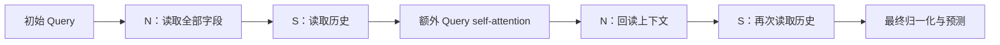

# KuaiRec 第七轮：初始信息记忆与归一化接口

八种结构均使用已有 seed=20262027 完成一轮训练，没有新增 seed 或复测。所有参考也取同 seed，测试集未评估。

## 改动

| 模型 | 相对直接父模型的改动 |
|---|---|
| r7_terminal_prenorm | 将序列 final norm 移到末尾字段回读之前 |
| r7_terminal_query_memory | 末尾上下文 K/V 附加初始 Query |
| r7_terminal_field_memory | 末尾上下文 K/V 附加首次完整字段编码 |
| r7_small_query_memory | 小模型第二次字段读取附加初始 Query |
| r7_small_field_memory | 小模型第二次字段读取附加首次字段编码 |
| r7_small_midnorm | 每次历史读取后先做序列 norm，再做额外 attention，去掉末尾重复 norm |
| r7_small_attention_last | 只保留最后一次额外 attention |
| r7_small_attention_first | 只保留第一次额外 attention |

三个 terminal 模型继承 r6_field_after，其余继承 r6_small_attention_after。记忆在一次 forward 内固定且保留梯度，没有额外可训练参数；初始 Query 与首次字段编码仅来自当前允许的原始字段。额外回读 K/V 从 30 个上下文 token 变为 30+8 个，原始历史源不变。这不是等计算量对照。所有模型与其直接父模型参数键、形状及数量相同。

## 同 seed 完整验证

| 模型 | AUC | ΔCross8 | ΔCross11 全 Query | Logloss | UAUC | NDCG@10 |
|---|---:|---:|---:|---:|---:|---:|
| cross8_original | 0.869547 | +0.000000 | -0.000426 | 0.189132 | 0.788347 | 0.404062 |
| cross8_matched | 0.870198 | +0.000651 | +0.000224 | 0.189931 | 0.788878 | 0.401591 |
| baseline_all | 0.869973 | +0.000426 | +0.000000 | 0.189433 | 0.786362 | 0.402129 |
| compact_seq1 | 0.870197 | +0.000650 | +0.000224 | 0.188830 | 0.790914 | 0.409850 |
| r6_field_after | 0.870420 | +0.000873 | +0.000447 | 0.189043 | 0.790519 | 0.409432 |
| r6_small_attention_after | 0.870153 | +0.000606 | +0.000179 | 0.188567 | 0.788920 | 0.410036 |
| r6_small | 0.869915 | +0.000368 | -0.000058 | 0.189212 | 0.790277 | 0.406755 |
| r7_small_attention_first | 0.871234 | +0.001687 | +0.001261 | 0.188067 | 0.790837 | 0.409856 |
| r7_small_midnorm | 0.870780 | +0.001233 | +0.000807 | 0.188237 | 0.787894 | 0.406471 |
| r7_terminal_prenorm | 0.869821 | +0.000274 | -0.000152 | 0.189297 | 0.789810 | 0.409525 |
| r7_terminal_query_memory | 0.869805 | +0.000258 | -0.000168 | 0.188831 | 0.790665 | 0.410483 |
| r7_small_field_memory | 0.868944 | -0.000603 | -0.001030 | 0.189544 | 0.789601 | 0.408844 |
| r7_small_query_memory | 0.868739 | -0.000808 | -0.001234 | 0.189727 | 0.787747 | 0.406021 |
| r7_small_attention_last | 0.868643 | -0.000904 | -0.001331 | 0.189319 | 0.790046 | 0.411488 |
| r7_terminal_field_memory | 0.868358 | -0.001189 | -0.001615 | 0.189955 | 0.790084 | 0.408827 |

同一 kuairec-loop-v1 数据哈希、标签/切分/严格早期历史，1 epoch、1240 更新、batch=8192、AdamW 1e-4 / Adagrad .05、clip=1、BF16、全 Query；原始 Cross8 的 clip=10 和匹配优化参考照旧保留。

## 直接父模型对照与成本

| 模型 | Δ父模型 AUC | Δ父模型 Logloss | 参数/M | p50/ms | p95/ms | 训练含验证/s | 峰值显存/GiB |
|---|---:|---:|---:|---:|---:|---:|---:|
| cross8_original | — | — | 9.232 | 13.51 | 13.55 | 448.7 | 16.67 |
| baseline_all | — | — | 11.408 | 14.84 | 14.88 | 495.1 | 18.88 |
| r6_field_after | — | — | 9.037 | 13.62 | 13.68 | 468.5 | 16.24 |
| r6_small_attention_after | — | — | 8.115 | 13.00 | 13.05 | 455.6 | 15.61 |
| r7_small_attention_first | +0.001081 | -0.000500 | 8.115 | 12.52 | 12.57 | 441.6 | 15.74 |
| r7_small_midnorm | +0.000628 | -0.000329 | 8.115 | 13.02 | 13.06 | 459.9 | 15.80 |
| r7_terminal_prenorm | -0.000599 | +0.000254 | 9.037 | 13.63 | 13.70 | 469.7 | 16.42 |
| r7_terminal_query_memory | -0.000615 | -0.000213 | 9.037 | 13.81 | 13.86 | 470.8 | 16.85 |
| r7_small_field_memory | -0.001209 | +0.000977 | 8.115 | 13.18 | 13.25 | 463.3 | 15.93 |
| r7_small_query_memory | -0.001413 | +0.001160 | 8.115 | 13.19 | 13.23 | 470.5 | 15.93 |
| r7_small_attention_last | -0.001510 | +0.000753 | 8.115 | 12.53 | 12.59 | 449.5 | 15.29 |
| r7_terminal_field_memory | -0.002062 | +0.000912 | 9.037 | 13.81 | 13.85 | 472.3 | 16.85 |

同卡 GPU 7 A800、BF16、真实 batch=1024、10 次预热、40 次前向。排除 IO，是单个重复 batch 的测量，不代表端到端服务性能。

## 正确性与复现

- CPU/GPU 各通过 5 项测试，覆盖两个父模型的输出/梯度精确兼容、八种调用顺序与 norm 位置、实际缓存张量和值、额外 K/V 的直接梯度、优化器覆盖、空历史/遮罩/输入不变性及最终 Query 干预位置。
- 归一化移位后用参数为空的 Identity 明确最终 Query 输出；诊断导出和 Zero/Shuffle 钩子跟随真实输出，防止误测中间 norm。原先模型仍使用原钩子，不改已有导出结果。
- [冻结计划](reports/round7/PLAN.md)、[配置](reports/round7/configs.json)、[矩阵状态](reports/round7/training/status.json)、[结果 JSON](reports/round7/summary.json)、[模型](model_zoo/QFormerCross11Memory.py)。
- 训练保存 checkpoint、预测、配置、输入/源码哈希；memory 追加记录，不覆盖旧实验。

## 结论与候选取舍

优先候选为 `r7_small_attention_first`：只保留一个独立字段块、一个独立历史块，两次循环共享权重，仅在第一次历史读取后执行额外 Query self-attention。其余 Cross11 块内部自带的 self-attention 保留。省略逐块 norm 的主调用顺序如下，N 两次共享字段权重，S 两次共享历史权重：

同 seed 验证 AUC=0.871234，比 Cross8 增加 0.001687，比 Cross11 全 Query 增加 0.001261，比上一轮最高的 `r6_field_after` 增加 0.000814。对直接父模型 `r6_small_attention_after`，AUC 增加 0.001081、Logloss 降低 0.000500、UAUC 增加 0.001917；NDCG 从 0.410036 略降至 0.409856，保留这一取舍。

新候选参数 8,115,473，与直接父模型相同；额外 attention 从两次降到一次，p50 从 13.00 降到 12.52 ms，减少约 3.7%。对 Cross8 参数减少 12.1%、前向耗时减少 7.4%；对 Cross11 参数减少 28.9%、耗时减少 15.7%。这是同卡重复真实 batch 的前向测量。

`r7_small_midnorm` 保留为第二候选：AUC=0.870780、Logloss=0.188237，均好于直接父模型；UAUC 从 0.788920 降至 0.787894，NDCG 从 0.410036 降至 0.406471，p50=13.02 ms。其收益依赖小模型接口，terminal prenorm 未改善对应父模型。

四种附加 K/V 记忆均未提升父模型 AUC，暂时降低优先级。`r7_terminal_query_memory` 仍接近 Cross8/Cross11，且比父模型改善 Logloss/NDCG，继续保留。只保留最后一次 attention 的 `r7_small_attention_last` AUC 下降，但 NDCG=0.411488；保存为排序指标取舍候选。全部配置、预测和较差结果均保留。

## rec-harness 诊断

两个候选均在固定的 57,408 条验证子集（7,176 用户）完成同权重扰动；表示和梯度覆盖 7,232 行。20 个 toolkit 调用全部成功，JSON 与 Markdown 已检查，checkpoint 未变化。

| 模型 | 原始子集 AUC | 关闭额外 attention | 改为一次循环 | 改为三次循环 | 最终 Q0 有效秩 |
|---|---:|---:|---:|---:|---:|
| r7_small_attention_first | 0.862199 | 0.858437 | 0.810410 | 0.828484 | 11.80 |
| r7_small_midnorm | 0.860886 | 0.849671 | 0.834920 | 0.834397 | 9.96 |

两者八个 Query 的梯度均有限且非零，逐个 Shuffle 均降低子集 AUC。关闭 attention 的分块平均 Logloss 增量分别为 +0.003124（95% block CI 0.002350–0.003942）和 +0.010427（0.008781–0.011859）。这些区间条件于固定 checkpoint，工具沿用既有 bootstrap 配置，不涉及新增训练 seed。

两个最终 Q0 均无零向量或死维度，但有效秩低于可用 256 维的 5%，工具标记为中等维度集中。对 midnorm，第二次序列 norm 的有效秩为 13.30，后续 attention 后真实输出为 9.96；因此本轮明确最终输出钩子是必要的。该几何信号不能单独证明表示坍缩，也不能据此删除 attention。直接改推理循环次数的退化仅说明现有权重依赖其训练结构，不等于从头训练其他深度必然更差。

诊断产物见 [first attention](reports/round7/r7_small_attention_first/summary.json)、[midnorm](reports/round7/r7_small_midnorm/summary.json) 和 [toolkit 状态](reports/round7/toolkit-candidates-status.json)。一次分析启动早于导出完成，被完成性检查拦截，随后在完整导出上成功重跑；记录见 [调度说明](reports/round7/orchestration-note.json)。

后续结构候选优先考虑“仅第一次 attention”与每轮归一化的组合，以及第一次 attention 的残差强度控制；尚未运行，继续遵守仅使用已有 seed 20262027 的约束。

以上是固定已有 seed 的结构筛选结果，不宣称稳定泛化收益。接近 Cross8 或 Cross11 的分支继续保留为优化候选；不增加 seed，也不使用测试集选择结构。
