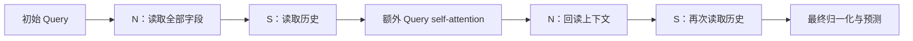

## 结论与候选取舍

优先候选为 `r7_small_attention_first`：只保留一个独立字段块、一个独立历史块，两次循环共享权重，仅在第一次历史读取后执行额外 Query self-attention。其余 Cross11 块内部自带的 self-attention 保留。省略逐块 norm 的主调用顺序如下，N 两次共享字段权重，S 两次共享历史权重：

同 seed 验证 AUC=0.871234，比 Cross8 增加 0.001687，比 Cross11 全 Query 增加 0.001261，比上一轮最高的 `r6_field_after` 增加 0.000814。对直接父模型 `r6_small_attention_after`，AUC 增加 0.001081、Logloss 降低 0.000500、UAUC 增加 0.001917；NDCG 从 0.410036 略降至 0.409856，保留这一取舍。

新候选参数 8,115,473，与直接父模型相同；额外 attention 从两次降到一次，p50 从 13.00 降到 12.52 ms，减少约 3.7%。对 Cross8 参数减少 12.1%、前向耗时减少 7.4%；对 Cross11 参数减少 28.9%、耗时减少 15.7%。这是同卡重复真实 batch 的前向测量。

`r7_small_midnorm` 保留为第二候选：AUC=0.870780、Logloss=0.188237，均好于直接父模型；UAUC 从 0.788920 降至 0.787894，NDCG 从 0.410036 降至 0.406471，p50=13.02 ms。其收益依赖小模型接口，terminal prenorm 未改善对应父模型。

四种附加 K/V 记忆均未提升父模型 AUC，暂时降低优先级。`r7_terminal_query_memory` 仍接近 Cross8/Cross11，且比父模型改善 Logloss/NDCG，继续保留。只保留最后一次 attention 的 `r7_small_attention_last` AUC 下降，但 NDCG=0.411488；保存为排序指标取舍候选。全部配置、预测和较差结果均保留。

## rec-harness 诊断

两个候选均在固定的 57,408 条验证子集（7,176 用户）完成同权重扰动；表示和梯度覆盖 7,232 行。20 个 toolkit 调用全部成功，JSON 与 Markdown 已检查，checkpoint 未变化。

| 模型 | 原始子集 AUC | 关闭额外 attention | 改为一次循环 | 改为三次循环 | 最终 Q0 有效秩 |
|---|---:|---:|---:|---:|---:|
| r7_small_attention_first | 0.862199 | 0.858437 | 0.810410 | 0.828484 | 11.80 |
| r7_small_midnorm | 0.860886 | 0.849671 | 0.834920 | 0.834397 | 9.96 |

两者八个 Query 的梯度均有限且非零，逐个 Shuffle 均降低子集 AUC。关闭 attention 的分块平均 Logloss 增量分别为 +0.003124（95% block CI 0.002350–0.003942）和 +0.010427（0.008781–0.011859）。这些区间条件于固定 checkpoint，工具沿用既有 bootstrap 配置，不涉及新增训练 seed。

两个最终 Q0 均无零向量或死维度，但有效秩低于可用 256 维的 5%，工具标记为中等维度集中。对 midnorm，第二次序列 norm 的有效秩为 13.30，后续 attention 后真实输出为 9.96；因此本轮明确最终输出钩子是必要的。该几何信号不能单独证明表示坍缩，也不能据此删除 attention。直接改推理循环次数的退化仅说明现有权重依赖其训练结构，不等于从头训练其他深度必然更差。

诊断产物见 [first attention](reports/round7/r7_small_attention_first/summary.json)、[midnorm](reports/round7/r7_small_midnorm/summary.json) 和 [toolkit 状态](reports/round7/toolkit-candidates-status.json)。一次分析启动早于导出完成，被完成性检查拦截，随后在完整导出上成功重跑；记录见 [调度说明](reports/round7/orchestration-note.json)。

后续结构候选优先考虑“仅第一次 attention”与每轮归一化的组合，以及第一次 attention 的残差强度控制；尚未运行，继续遵守仅使用已有 seed 20262027 的约束。
