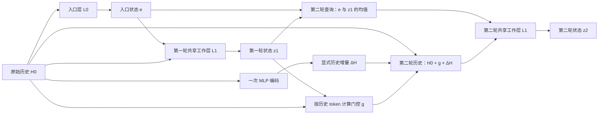

# ITT 启发与本轮能回答的问题

用户确认的论文是百度参与的 [Inner Thinking Transformer，ACL 2025](https://aclanthology.org/2025.acl-long.1369.pdf)。原文 §3.2 的 RTC 让共享变换读取上一步累计状态，再累积经过 thinking-step 通道权重调制的结果；§3.3 的路由器选择和加权继续计算的 token。原文 Table 3 的语言模型消融支持这些设计在其训练设置中有价值，不能直接推出推荐任务的 AUC 增益。

“循环的信息增量”在这里指相同输入经过计算后，得到对预测更有用的表示，不意味着模型凭空获得新的外部观测。需要区分三个位置：第二轮的查询条件、被读取的历史表示、跨轮结果的积累方式。只改变其中一个位置，不能证明另两个位置没有价值。

本地原有第二轮查询已经使用 `(e + z1) / 2`，因此第一轮工作状态并未完全丢失。之前的历史版本实验预先计算 `H1=G(H0)`、`H2=G(H1)`，它们不依赖 `z1`。其 SD 相对成熟输入两轮基线的宏 AUC 差为 +0.000289，95% 用户 bootstrap 区间跨零，推理延迟约增加 46.65%。它提供了读取位置的研究线索，还没有形成整体质量与效率的改进模型。已完成的结果见 [上一轮报告](../recurrence-history-versions/RESULTS.md)。

本轮固定两次工作读取、原查询公式和无预测状态反馈，八组分别检查：

1. attention 编码一次，放在第一轮、第二轮或两轮的历史读取中。
2. 对应三个位置改用逐 token MLP，评估编码结构、容量和成本一起变化的效果。
3. 同样的 MLP 历史增量，分别由入口 `e` 和第一轮工作状态 `z1` 控制门控。两组模块、参数量和调用次数相同，组内初始化相同。

第 3 项的直接差值最接近当前问题：第一轮工作状态是否比入口状态更适合控制第二轮读取的历史增量。即使 work 门控胜过 entry 门控，也必须同时比较成熟输入两轮基线与 Cross8，才能判断是否得到有用的模型。与无门控 MLP 的比较还包含新增参数和调制机制的影响。

下面画出工作状态门控方案的两次历史读取。入口门控对照只将通向门控的 `z1` 换成 `e`；第二轮查询公式不变。预测分支未画出，它不反馈到这条工作路径。

这里“来源唯一不同”描述的是结构对照。由于门控对条件可微，两个模型的完整训练路径也会随之改变；它不是固定权重下的信息量测量。

本轮没有实现 ITT 的硬 token 路由、动态停止或完整 RTC，不称为 ITT 复现。ITT 的 Algorithm 1 携带 `KV_new`，但对覆盖、追加和未选位置的语义交代不足，不能据此断言它每轮重写全部历史 K/V。

对任务差异，只使用预先声明的四任务 AUC/BCE 和任务间直接差值。某任务显著、另一任务不显著，本身不能证明两者收益不同。固定 seed 的用户 bootstrap 也不覆盖训练随机性或多次选模型的不确定性。
