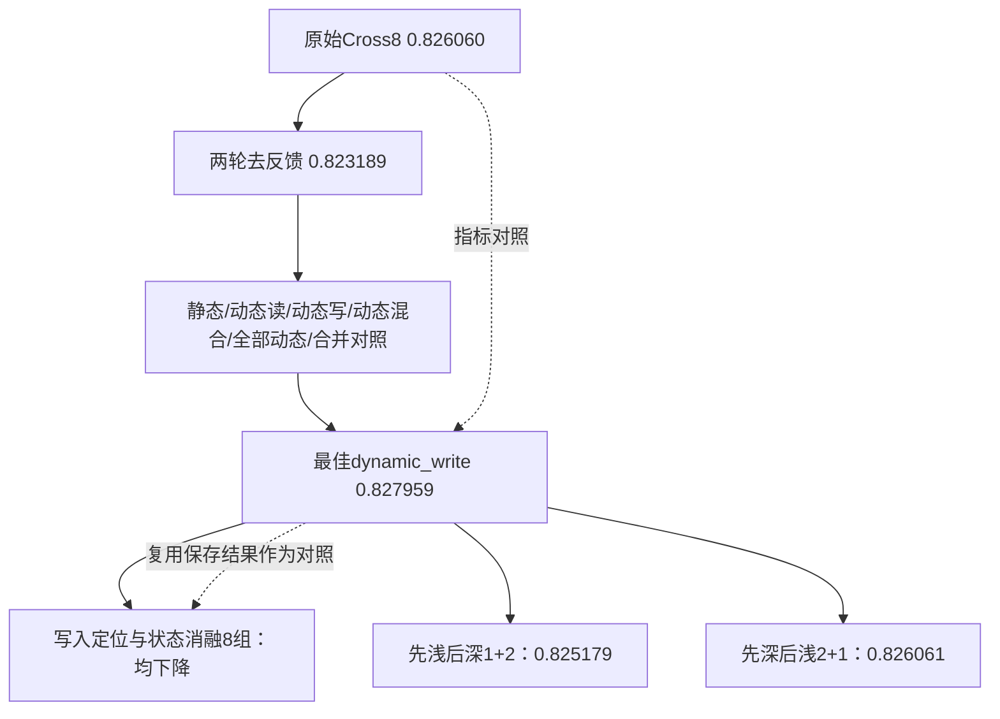

# 实验血缘图

示意图汇总结构研究路径，不表示各组顺序微调；18个模型均为固定seed独立从初始化训练。各轮原始参数初始化一致，旧参照结果复用。

[完整交互图HTML](lineage/index.html)需要下载后在浏览器打开，GitHub文件页不运行HTML；[完整节点/边JSON](lineage/experiments.json)与[生成器](lineage/update.py)同时归档。快照包含515条历史实验/诊断节点：KuaiRec233、淘宝282，本次新增18条。历史`recorded_parent`沿用原账本含义，当前研究分别标注结构与指标对照边。

用户要求每次实验更新血缘图，现已接入worker启动/终止及账本收尾；此处为上传时静态快照，工作区图继续随未来实验更新。
