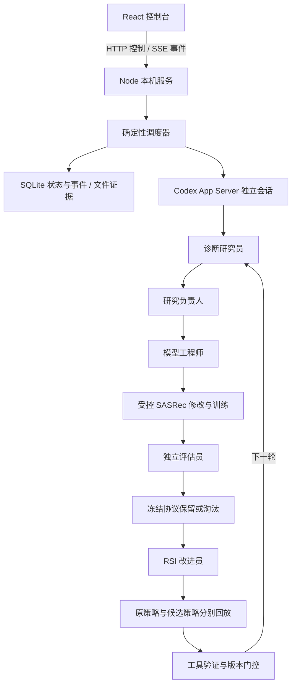

# Codex 多 Agent 双层进化架构

## 已实现的数据流

五个角色以独立 thread/turn 运行，通过结构化回执和实验产物交接。当前是串行多 Agent 工作流，不是并行调度或自由协商的 Agent 网络。每轮另外创建两次独立评估会话进行策略对照回放。调度器负责预算、进程终止、状态持久化和版本启用。

## 两层改进对象

- 模型层：SASRec 候选代码、验证 NDCG@5 与 HR@5、父版本和保留／淘汰证据。当前修改限制为 ReLU→GELU 或层数变换。
- 外层 RSI：诊断工具、Skill 草案和研究策略。复用三个项目内 Skill 与 propose / handoff / check / close 门控；工具可靠性与模型收益分别验证。
- 策略回放得分提高不自动意味着真实研究能力提高。当前缺少独立真实任务同预算效用验证的候选不会自动启用；通过门控后的启用与回退路径已有受控测试。

## 接口与运行边界

浏览器通过 `/api/runs` 创建实验，`/api/runs/:id/control` 控制状态，通过 `/api/runs/:id/stream` 获取带序号事件。模型、RSI 版本、协议和证据由后端关联；原始产物通过受限文件接口读取。

默认绑定 `127.0.0.1:4317`，并校验 Host / Origin。远程浏览器访问尚需平台代理或受保护入口；当前分支没有解决无 SSH 环境的公网访问。登录凭据保留在服务器，Agent 不能修改调度器或冻结评估器。

控制台已有双轨版本、指标曲线和轮次证据；改进前后专门对比视图尚未实现。历史滑块仅回放事件，上方版本和指标显示最终状态。

## 验证与来源

运行步骤见 [README](README.md)，既有真实实验摘要见 [ACCEPTANCE](ACCEPTANCE.md)。源码发布排除运行数据库、原始会话、逐用户结果、模型、依赖及凭据。

`skills/` 保存运行时所使用的 Skill 快照，来源与指纹见 `skills.snapshot.json` 和 `upstream.lock.json`，不要求覆盖仓库根目录的 Skill。上游 Self-EvolveRec 在安装时按固定提交获取。
